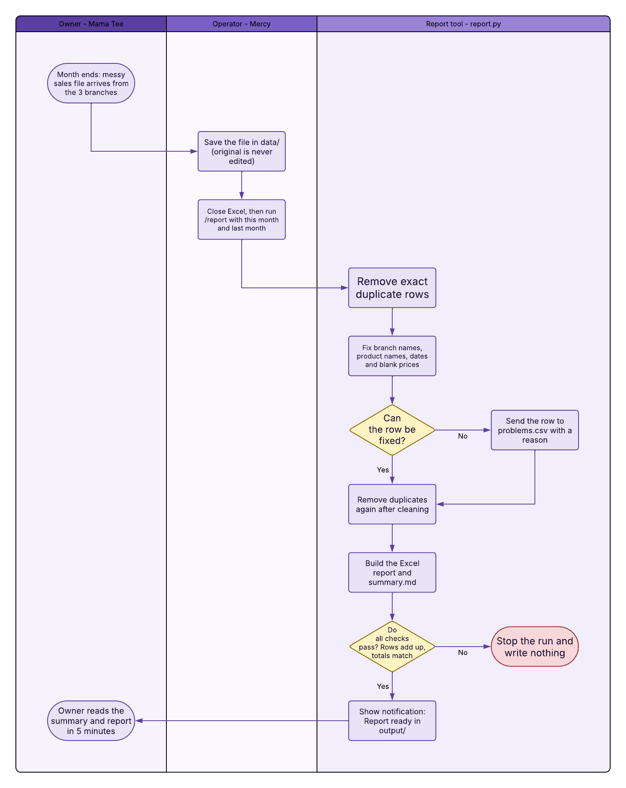

# Operations overview

## 1. Why this project

This is a class assignment. The client, Mama Tee's Bakery, is made up. It has three branches in Abuja: Wuse, Garki and Maitama.

## 2. The problem

Each month the owner gets a messy sales spreadsheet. Branch names are spelled in different ways, dates come in mixed formats, some rows are duplicated and some prices are missing. She spends two days cleaning it before she can see how the month went.

## 3. The objective

Turn a messy monthly file into a finished report she can understand in five minutes, with one command.

## 4. How we know it works

- Branch totals (Wuse + Garki + Maitama) equal the grand total.
- Every duplicate row is gone.
- `problems.csv` explains every row the tool could not fix.
- Rows read equal clean rows plus duplicates plus problem rows.

## 5. Who does what

- **Owner (Mama Tee):** sends the month's sales file and reads the summary and report.
- **Operator (Mercy):** saves the file in `data/`, closes Excel and runs `/report`.
- **Tool (`report.py`):** cleans the data, runs the checks and writes the files in `output/`.

## 6. The process

*Who does what, from the messy file arriving to the owner reading the report.*

1. The month ends and the messy sales file arrives from the three branches.
2. The operator saves the file in `data/`. The original is never edited.
3. The operator closes Excel and runs `/report` with this month and last month.
4. The tool removes exact duplicate rows.
5. The tool fixes branch names, product names, dates and blank prices.
6. Rows it cannot fix go to `problems.csv` with a reason.
7. The tool removes duplicates again, for rows that only matched after cleaning.
8. The tool builds the Excel report and `summary.md`.
9. The tool checks that the rows add up and the totals match. If any check fails, the run stops and writes nothing.
10. If all checks pass, a notification says "Report ready in output/".
11. The owner reads the summary and report in five minutes.

## 7. Controls

- The original file is never edited. Files in `data/` are read-only.
- If any check fails, the run stops and writes nothing.
- Rows that cannot be fixed go to `problems.csv` with a reason.

## 8. Monthly routine

1. Save the new month's CSV in `data/` and close the Excel report if it is open.
2. Run `/report data/THIS-MONTH.csv data/LAST-MONTH.csv` in Claude Code.
3. Check that every line says OK, then give the owner `output/summary.md` and `output/sales-report.xlsx`.

## 9. Left out on purpose

- Automatic email of the report.
- An HTML version of the report.
